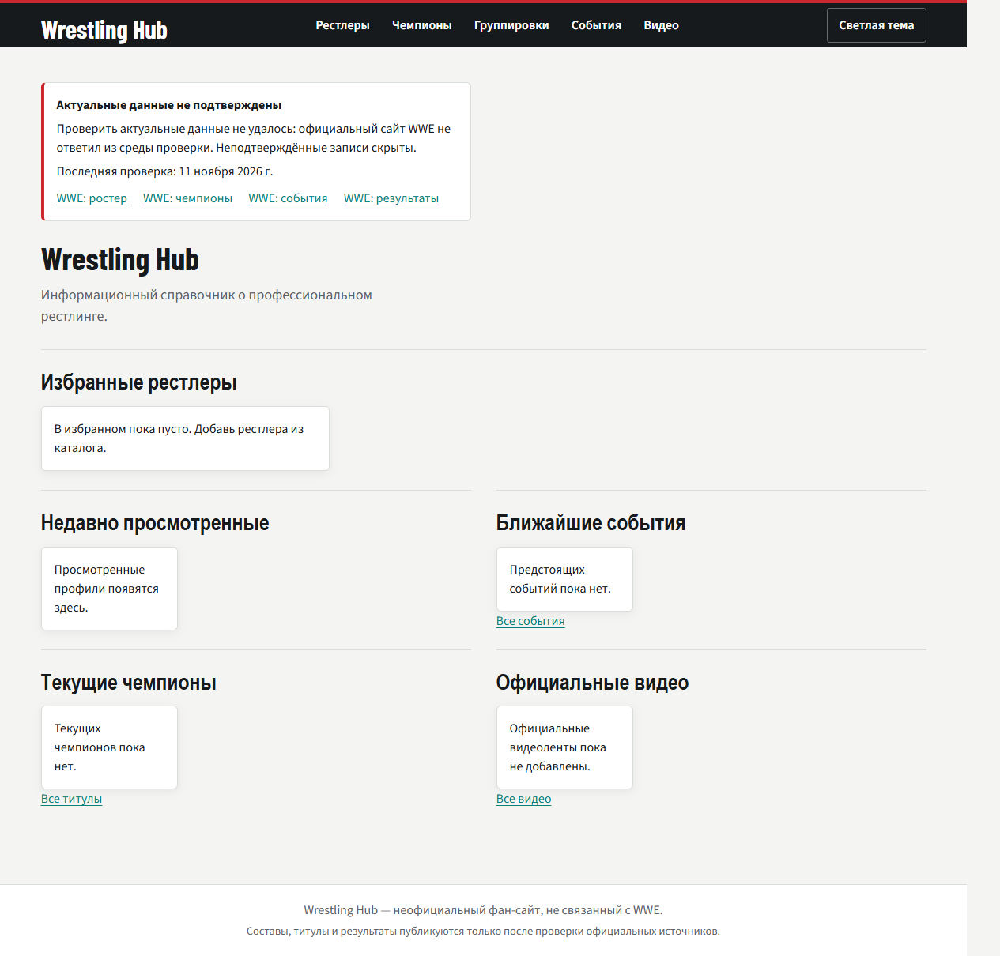
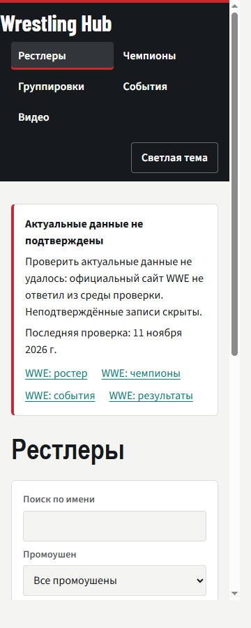

# Wrestling Hub

Неофициальный фан-сайт о профессиональном рестлинге. Проект не связан с WWE. Публикуются только записи с датированной ссылкой на официальный источник; неподтверждённые сведения скрываются.

## Возможности

- Каталог рестлеров с поиском и фильтрами по промоушену, бренду и статусу.
- Профили, титулы, группировки, события и результаты с межфайловыми связями по `id`.
- Избранное, тема оформления и последние просмотренные профили в LocalStorage.
- Видимый статус проверки источников и ссылки на официальные страницы WWE.

## Текущая доступность данных

На 11 ноября 2026 года официальный сайт WWE не удалось открыть из среды проверки. Поэтому файлы `wrestlers.json`, `championships.json`, `factions.json`, `events.json` и `videos.json` оставлены пустыми: вымышленные записи удалены, неподтверждённые чемпионы и результаты не показываются. Статус и ссылки на источники находятся в `data/source-status.json`.

## Запуск локально

Страницы загружают JSON через `fetch`, поэтому открывайте сайт через HTTP-сервер, а не напрямую как `file://`.

```powershell
python -m http.server 8000
```

Затем откройте <http://localhost:8000/>. Остановка сервера: `Ctrl+C` в терминале.

## Структура

```text
.
├── index.html
├── wrestlers.html
├── wrestler.html
├── championships.html
├── factions.html
├── events.html
├── event.html
├── videos.html
├── data/
│   ├── wrestlers.json
│   ├── championships.json
│   ├── factions.json
│   ├── events.json
│   ├── videos.json
│   └── source-status.json
├── css/style.css
├── js/
│   ├── data.js
│   └── main.js
└── assets/screenshots/
```

Связи между JSON-записями хранятся через `id`; поле `promotion` задаёт промоушен. Для локального состояния используются ключи `wrestlingHubFavorites`, `wrestlingHubTheme` и `wrestlingHubRecentlyViewed`.

Каждая запись перед публикацией должна содержать `sourceUrl` (HTTPS) и `verifiedAt` (`YYYY-MM-DD`). Каждая запись о титульном периоде и каждый матч также должны иметь собственные `sourceUrl` и `verifiedAt`. Для матча будущего события обязательно указывается `confirmationStatus: "confirmed"` или `confirmationStatus: "rumor"`. Загрузчик отклоняет записи без этих полей.

## Скриншоты

Главная, desktop:



Каталог, мобильная ширина 360px:



## Проверки перед релизом

- Проверить поиск и фильтры по промоушену, бренду и статусу; кнопка сброса должна возвращать все записи.
- Добавить и удалить рестлера из избранного, затем проверить состояние после перезагрузки.
- Переключить тему и проверить её сохранение после перезагрузки.
- Открыть несколько профилей и проверить список последних просмотренных (не более пяти).
- Проверить переходы к событиям и отображение результатов матчей.
- Проверить клавиатурную навигацию, видимый фокус, подписи полей и контраст.
- Запустить Lighthouse для Performance, Accessibility и SEO; целевой результат — не ниже 90.
- Повторить проверки в актуальных Chrome, Edge и Firefox на ширинах 360, 768 и 1280px.

Локальная браузерная проверка выполнена в Chromium: все восемь маршрутов открываются, статус источников виден, ширины 360, 768 и 1280px не дают горизонтального переполнения. При пустых наборах содержательные проверки поиска, фильтров и карточек нужно повторить после добавления подтверждённых записей. Lighthouse и кросс-браузерная проверка не выполнены.

## Видео

`data/videos.json` сейчас пуст. Добавляйте только конкретные бесплатные видео с проверенной официальной страницы или канала, указывая `sourceUrl` и дату проверки. Встраивание и парсинг сторонних страниц не используются.

## GitHub Pages

1. Создайте Git-репозиторий и загрузите проект на GitHub.
2. Откройте **Settings → Pages**.
3. В разделе сборки выберите **Deploy from a branch**, ветку `main` и папку `/(root)`.
4. Сохраните настройки и дождитесь публикации.

Проект не использует сборщик или серверную часть; GitHub Pages может публиковать HTML, CSS, JS и JSON напрямую. В текущей рабочей папке Git-метаданные не обнаружены, поэтому удалённая публикация ещё не настроена.
